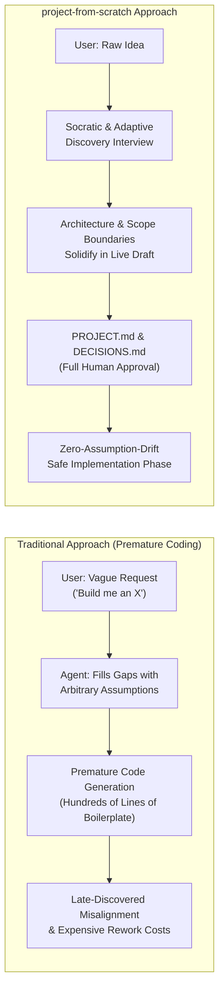
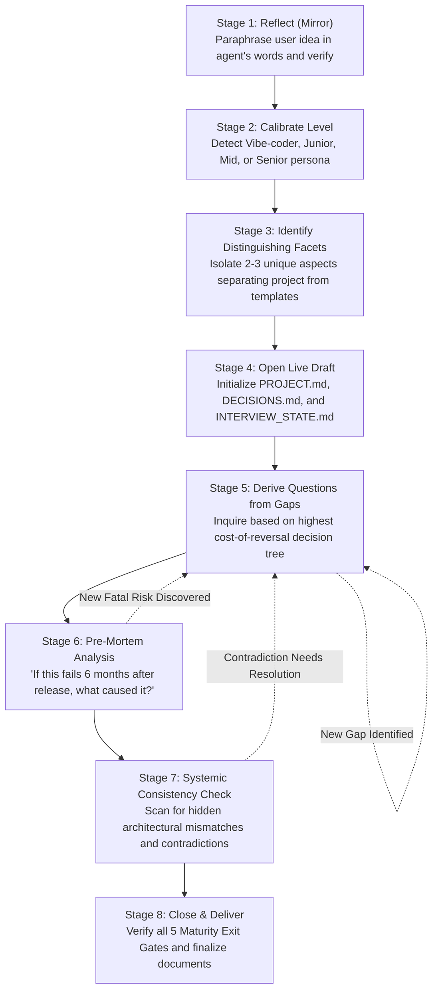
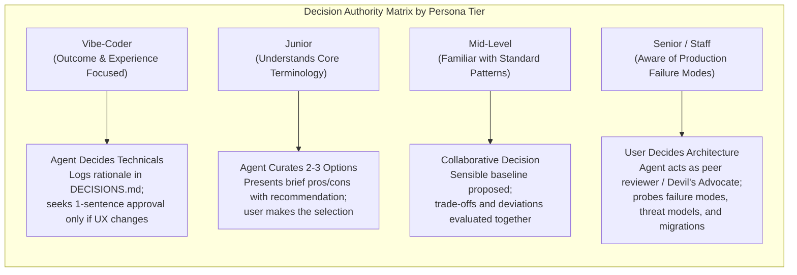
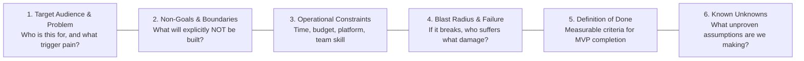
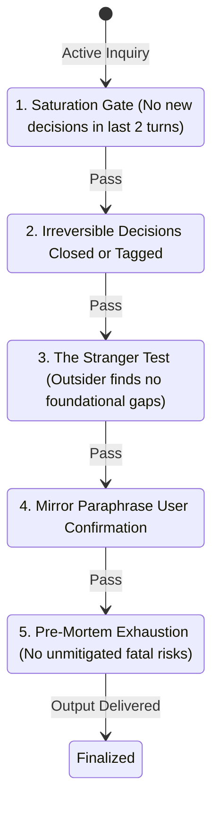

# project-from-scratch

> **Adaptive Project Discovery & Specification Skill: Solidifying Ideas Before Writing Code**

---

## 1. Problem: The Flaw of "Prompt-and-Pray" Premature Coding

Modern developers and creators working with advanced AI agents frequently start projects by saying *"build me X"*, leaping straight into code generation. In most cases, however, requirements, architectural constraints, data flows, and operational boundaries remain undefined in the user's mind.

Confronted with logical voids, the AI agent fills in the blanks with its own arbitrary assumptions. The resulting system diverges from the user's true intent. When the user discovers this divergence after thousands of lines of code have already been written, rectifying the architecture is both expensive and demoralizing.

The root problem is **not a deficiency in coding skill**, but the **omission of the foundational conceptualization phase**.



---

## 2. One-Sentence Definition & Scope Boundaries

> **The agent conducts an adaptive, highly calibrated discovery interview until the project's true shape solidifies, delivering a comprehensive, human-readable project specification and architecture decision log without writing a single line of code.**

### Strict Non-Goals (Out of Scope)
- **Writing Application Code**: No source code, scaffolding, or test scripts are produced.
- **Task List Generation**: No Jira tickets, GitHub issues, or sprint backlogs are created.
- **Downstream Agent Prompt Scripting**: No prompt orchestration files for other AI bots are prepared.

The sole output of this skill is documentation that an engineering lead, investor, or the creator themselves can read from start to finish and declare: *"Yes, this is precisely what I intend to build."*

---

## 3. Core Architectural Principles

| Principle | Description |
| :--- | :--- |
| **Universal Project Neutrality** | Never assumes a standard web or mobile SaaS application by default. An offline retro 2D game, a Windows automation macro, an air-gapped server control panel, or an embedded microcontroller hub are treated with equal rigor. |
| **Zero Boilerplate Questionnaires** | Static question banks trap agents in narrow templates. Questions derive dynamically from preceding user answers and the highest-risk unresolved architectural gaps. |
| **Maturity-Driven Completion** | The interview is bounded by 5 objective maturity gates, never by an arbitrary question counter or turn limit. |
| **Adaptive Responsibility** | User skill level does not change *what* architectural decisions must be made; it changes **who makes them** and **how they are explained**. |
| **Preservation of Known Unknowns** | An answer of *"I don't know"* is never discarded or glossed over. It is explicitly recorded with its rationale under an `[ASSUMED / REVIEW_REQUIRED]` tag. |

---

## 4. The 8-Stage Interview Lifecycle



### Stage Details

1. **Reflect (Mirror)**: The user describes their initial concept. The agent mirrors it back without premature categorization: *"What I understand is you want to solve [X] for [Y], and the absolute crux is [Z]. Did I capture this accurately?"* No deep questioning begins until the user confirms.
2. **Calibrate Level**: The user indicates their baseline background. Multi-disciplinary calibration occurs dynamically throughout the interview (e.g., Senior in backend architecture, Vibe-Coder in user interfaces).
3. **Identify Distinguishing Facets**: Every project has 2-3 unfamiliar, non-standard aspects. 70% of discovery depth focuses on these differentiating factors rather than commodity boilerplate.
4. **Open Live Draft**: Immediately following Round 1, `PROJECT.md`, `DECISIONS.md`, and `INTERVIEW_STATE.md` are initialized. Unresolved items are marked `[OPEN]` and updated in real time with each answer.
5. **Derive Questions from Gaps**: Using Decision Tree logic, decisions that are expensive or irreversible to change later (data consistency models, hosting topology, platform constraints) are prioritized over cosmetic details.
6. **Pre-Mortem Analysis**: Conducted midway and near closure: *"Suppose this project launched, and 6 months from now it completely failed. What was the single most likely technical, operational, or adoption reason?"*
7. **Systemic Consistency Check**: Scans for internal mismatches (e.g., \$0/mo budget combined with multi-region managed clusters; international billing without refund or tax policies).
8. **Close & Deliver**: The 5 objective exit gates are validated, and finalized documents are delivered.

---

## 5. Persona Calibration & Decision Matrix

User level dictates **who holds decision authority** and **the communication register**, not which decisions exist.



### Universal Escape Hatch ("I Don't Know / You Decide")
At any persona level, the user may say *"I don't know / you decide / doesn't matter"*:
- The agent selects the most robust, lowest-complexity industry standard.
- The choice is logged in `DECISIONS.md` under `Decider: Agent (Delegated)`.
- The item is marked `[ASSUMED / REVIEW_REQUIRED]` in `PROJECT.md`.
- The interview continues seamlessly without friction.

---

## 6. The 6 Immutable Scope Dimensions

Rather than static question lists, every project must satisfy 6 immutable scope dimensions (`dimensions.md`):



---

## 7. Architectural Trigger Heuristics

When specific technical concepts emerge in conversation, heuristic risk alerts from `triggers.md` activate internally:

- **Authentication & User Identity**: Session lifecycles, account recovery, tenant isolation, data deletion rights (GDPR/CCPA).
- **Billing & Commerce**: Merchant of Record (MoR), dunning management, dispute policies, double-entry ledger bookkeeping.
- **User-Generated Content (UGC)**: Presigned direct uploads, malware sanitization, storage cost explosion mitigation, moderation queues.
- **Real-Time State Synchronization**: Connection drops, client state reconciliation, conflict resolution (CRDTs vs. LWW), backpressure limits.
- **Automation & Scraping**: Selector resilience, request jitter, anti-ban throttling, emergency hardware kill-switch.
- **Embedded & Hardware**: Power envelopes, intermittent connectivity buffering, dual-bank failsafe OTA firmware updates.

---

## 8. Five Objective Maturity Exit Gates

The interview cannot conclude arbitrarily. Progression to delivery requires passing all 5 gates:



### Exit Hatches & Fatigue Mitigation
- **User-Initiated Stop**: The user may say *"Let's stop here"* at any time. Remaining gaps are converted to documented sensible defaults tagged `[ASSUMED / REVIEW_REQUIRED]`.
- **Fatigue Detection**: If the user provides 2+ consecutive monosyllabic answers (*"ok"*, *"whatever"*), the agent ceases open questioning and offers to finalize with industry defaults.
- **Periodic Checkpoint Cadence**: Every 15–20 interactions, a status summary is presented: *"Here is our current specification progress. Shall we investigate [Specific Gap] or wrap up with documented assumptions?"*

---

## 9. Output Artifacts & Directory Structure

Upon completion, three core documents are finalized in the repository:

1. **`PROJECT.md`**: Master specification containing vision, personas, boundaries, blast radius, dynamic project-specific modules, and acceptance gates.
2. **`DECISIONS.md`**: Architecture Decision Record (ADR) logging all chosen options, rejected alternatives, rationales, and deciders (User vs. Agent).
3. **`INTERVIEW_STATE.md`**: Real-time tracker maintaining dimension completeness, priority gap queue, and saturation status.

```
project-from-scratch/
├── SKILL.md              # Master orchestration instructions and 5 exit gates
├── README.md             # Repository documentation and architectural philosophy
├── dimensions.md         # 6 immutable scope dimensions checklist
├── triggers.md           # Heuristic risk alerts across complex subsystems
├── levels/               # Persona-specific communication and delegation guides
│   ├── vibe-coder.md
│   ├── junior.md
│   ├── mid.md
│   └── senior.md
├── templates/            # Output document templates
│   ├── PROJECT.md
│   ├── DECISIONS.md
│   └── INTERVIEW_STATE.md
└── examples/             # Reference mental models across diverse domains
    ├── 01-game-roguelike.md
    ├── 02-automation-macro.md
    ├── 03-server-control-panel.md
    ├── 04-hardware-iot-hub.md
    └── 05-niche-social-platform.md
```

---

## 10. Usage & Invocation

To initiate a project discovery interview within Antigravity or any compatible agent runtime, trigger with:

```markdown
"I have a new project idea, let's start with project-from-scratch."
"Start a new project discovery interview using project-from-scratch."
"project-from-scratch"
```
