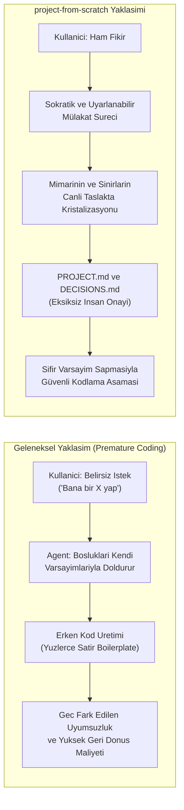
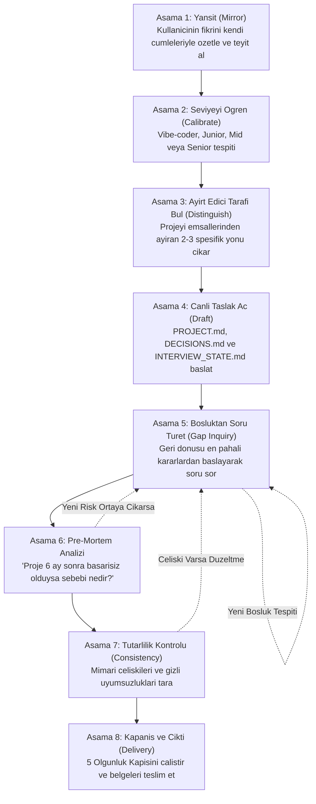
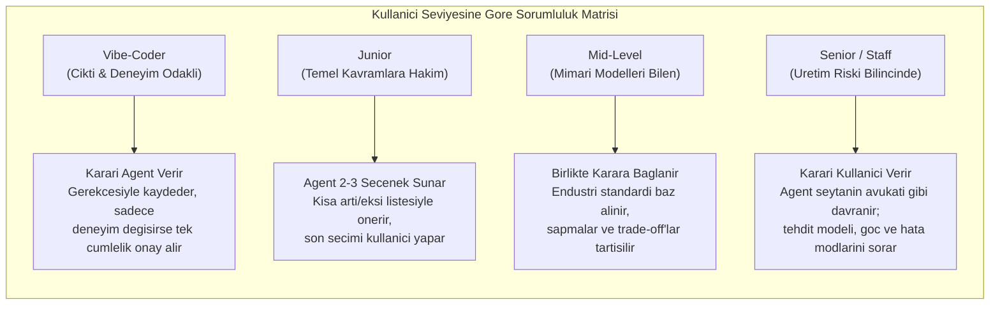
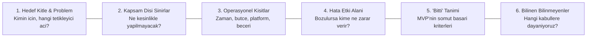
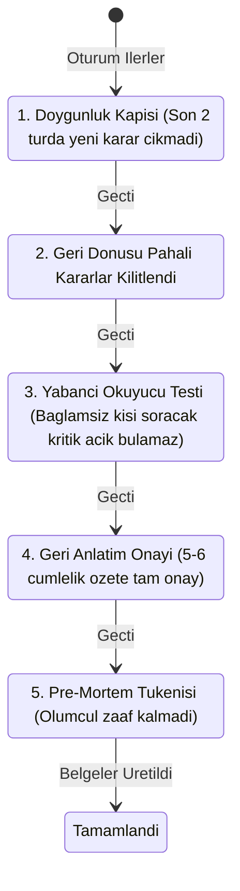

# project-from-scratch

> **Kod Yazmadan Once Fikri Kristalize Eden, Uyarlanabilir Proje Kesif ve Sartname Sistemi**

---

## 1. Problem: "Prompt-and-Pray" Yaklasiminin Kusurlari

Geliskin yapay zeka modelleriyle calisan kullanicilar siklikla *"bana sunu yap"* diyerek dogrudan kodlama asamasina gecmektedir. Ancak cogu zaman gereksinimler, mimari kisitlar, veri akislari ve sinirlar kullanicinin zihninde henuz netlesmemistir.

Karsilastigi mantiksal bosluklari kendi varsayimlariyla dolduran yapay zeka agent'i, kullanicinin gercek ihtiyacindan sapan bir mimari insa eder. Kullanici bu sapmayi binlerce satir kod yazildiktan sonra fark ettiginde, geri donus hem maliyetli hem de yipratici olur.

Sorun yapay zekanin kod yazma yeteneginde degil; **projenin temel tasarim ve dusunce asamasinin atlanmasindadir**.



---

## 2. Tek Cumlelik Tanim ve Kapsam Sinirlari

> **Agent, kullaniciya projenin gercek sekli ortaya cikana kadar seviyesine gore uyarlanmis sorular sorar ve tek bir satir bile kod yazmadan, fikri derinlemesine tanimlayan insan tarafindan onaylanabilir bir proje sartnamesi ve mimari karar kaydi uretir.**

### Kapsam Disi Olan Alanlar (Strict Non-Goals)
- **Kod Yazimi**: Kaynak kod, scaffolding veya test scripti uretilmez.
- **Gorev Listesi Cikarma**: Jira, GitHub issues veya sprint gorev listesi hazirlanmaz.
- **Agent Promptu Hazirlama**: Baska bir yapay zekaya dogrudan beslenecek prompt komut dosyalari yazilmaz.

Bu skill'in tek urunu; teknik bir liderin, yatirimcinin veya kullanicinin kendisinin bastan sona okuyup *"Evet, tam olarak insa etmek istedigim sistem bu"* diyebilecegi netlikte bir dokumantasyondur.

---

## 3. Temel Mimari Ilkeler

| Ilke | Aciklama |
| :--- | :--- |
| **Evrensel Proje Tarafsizligi** | Projeyi peşinen standart bir web/mobil SaaS uygulamasi varsaymaz. Oyun, yerel makro scripti, hava bosluklu sunucu paneli veya mikrokontrolcu firmware'i ayni titizlikle ele alinir. |
| **Sifir Sabit Soru Kalibi** | Hazir soru bankalari agent'i kaliplara hapseder. Sorular, kullanicinin onceki cevaplarindan ve belgedeki en riskli mimari bosluklardan dinamik olarak turetilir. |
| **Olgunluk Odakli Kapanis** | Sureci keyfi bir soru sayaci veya sure degil; 5 nesnel olgunluk testinin basariyla tamamlanmasi belirler. |
| **Uyarlanabilir Sorumluluk** | Kullanici seviyesi hangi kararlarin verilecegini degil; **karari kimin verecegini** ve **nasil anlatilacagini** belirler. |
| **Bilinmeyenlerin Korunumu** | *"Bilmiyorum"* yaniti asla gormezden gelinmez veya gecistirilmez. Gerekcesiyle birlikte `[ASSUMED / GOZDEN GECIR]` etiketiyle kayda gecer. |

---

## 4. 8 Asamali Kesif Sureci



### Surec Adimlarinin Detaylari

1. **Yansit (Reflect)**: Kullanici fikrini anlatir. Agent fikri herhangi bir kategoriye sokmadan kendi cumleleriyle ozetler: *"Anladigim kadariyla X kitlesi icin Y problemini cozmek istiyorsun ve sistemin kalbi Z. Dogru mu?"* Kullanici onaylayana kadar derinlesilmez.
2. **Seviyeyi Ogren (Calibrate Level)**: Kullanici kendini tanimlar. Mülakat esnasinda alan bazli ince ayar yapilir (ornek: backend'de Senior, arayuzde Vibe-Coder).
3. **Ayirt Edici Tarafi Bul (Identify Distinguishing Facets)**: Standart cozumlerin disina cikan 2-3 alisildik olmayan yon belirlenir. Mülakat derinliginin yuzde 70'i bu cekirdege yonlendirilir.
4. **Canli Taslak Ac (Open Live Draft)**: Ilk turun ardindan `PROJECT.md`, `DECISIONS.md` ve `INTERVIEW_STATE.md` dosyalari baslatilir. Bilinmeyen her baslik `[ACIK / OPEN]` olarak isaretlenir ve her cevapla birlikte anlik guncellenir.
5. **Bosluktan Soru Turet (Derive Questions from Gaps)**: Karar agaci mantigiyla, geri donusu en maliyetli ve mimariyi kilitleyen kararlar (veri modeli, bagimliliklar, barindirma yapisi) oncelikle sorulur.
6. **Pre-Mortem Analizi**: Mülakatin ortasinda ve kapanis oncesinde ters yuz edilmis risk analizi yapilir: *"Bu proje yayina girdikten 6 ay sonra tamamen terk edildiyse en olasi teknik veya operasyonel sebebi neydi?"*
7. **Sistemik Tutarlilik Kontrolu (Consistency Check)**: Belge kapatilmadan once celiskiler taranir (ornek: "0 dolar butce ile cok bolgeli yonetilen K8s", "Stripe ile odeme ama iade/vergi politikasi yok").
8. **Kapanis ve Cikti (Closure & Delivery)**: 5 olgunluk kapisi dogrulanarak nihai belgeler sunulur.

---

## 5. Seviye Sistemi ve Sorumluluk Dagilimi

Seviye farki, hangi sorularin atlanacagini degil; **karari kimin verecegini** ve **terminolojinin nasil kurgulanacagini** belirler.



### Evrensel Kacis Kapisi ("Bilmiyorum / Sen Karar Ver")
Hangi seviyede olursa olsun, kullanici herhangi bir soruda *"Bilmiyorum, sen karar ver"* veya *"Fark etmez"* diyebilir.
- Agent bekleme yapmaz veya kullaniciyi zorlamaz.
- En dusuk karmasikliga sahip endustri standardini secer.
- Karari `DECISIONS.md` dosyasina `Decider: Agent (Delegated)` olarak yazar.
- `PROJECT.md` uzerinde `[ASSUMED / GOZDEN GECIR]` etiketiyle kaydeder.

---

## 6. Sabit Kapsam Boyutlari (Scope Checklist)

Hazir soru listeleri yerine, projenin turunden bagimsiz olarak her sistemde cevaplanmasi zorunlu olan 6 sabit boyut (`dimensions.md`) takip edilir:



---

## 7. Mimari Tetikleyici Sistemi (Triggers Heuristic)

Kullanici mülakat sirasinda belirli kritik kavramlari zikrettiginde, `triggers.md` dosyasindaki mimari risk alarmlari devreye girer. Bunlar kullaniciya dogrudan sorulan kaliplar degil; agent'in mimaride bosluk birakmamak icin kullandigi bilinc alarmlaridir:

- **Kullanici Kimligi ve Hesaplar**: Oturum stratejisi, hesap kurtarma, cok kiracilik (multi-tenancy), veri silme hakki (KVKK/GDPR).
- **Odemeler ve Abonelik**: Merchant of Record (MoR), basarisiz odeme takibi (dunning), iade politikalari, cift girisli bakiye defteri.
- **Kullanici Icerigi (UGC)**: Guvenli yukleme, zararlı yazilim taramasi, dosya boyutu sinirlari, depolama maliyet patlamasi onleme.
- **Gercek Zamanli Iletisim**: Baglanti kopmasi ve yeniden senkronizasyon, cakisim cozumleme, sunucu sisme (backpressure) kontrolleri.
- **Otomasyon ve Kazima (Scraping)**: Hedef sistem degisikligi direnci, istek yavaslatma (jitter), aninda acil durdurma anahtari (kill-switch).
- **Gomulu ve Donanim**: Guc butcesi, kesintili baglanti kuyrugu, guvenli OTA yazilim guncelleme ve geri donus mekanizmasi.

---

## 8. Bes Asamali Bitis Kapisi (Maturity Exit Gates)

Mülakat keyfi olarak veya kullanici yorulana kadar rastgele uzatilmaz. Asagidaki 5 kapi dogrulandiginda oturum resmi olarak tamamlanir:



### Cikis Kapilari ve Yorgunluk Yonetimi
- **Kullanici Istegiyle Cikis**: Kullanici istedigi an *"Burada bitirelim"* diyebilir. Kalan bosluklar varsayim olarak doldurulur ve `[ASSUMED / GOZDEN GECIR]` etiketi alir.
- **Yorgunluk Algilayici**: Kullanici ust uste 2 veya daha fazla tek kelimelik veya *"fark etmez"* yaniti verirse, agent derin soru sormayi birakir; endustri standartlariyla belgeyi kapatmayi onerir.
- **Periyodik Kontrol Noktasi**: Yaklasik her 15-20 etkilesimde bir mevcut durumun ozeti gosterilir: *"Su an bu noktadayiz, X konusu mu netlestirelim yoksa varsayimlarla kapatip ciktiyi alalim mi?"*

---

## 9. Cikti Belgeleri ve Dosya Hiyerarsisi

Mülakatin tamamlanmasiyla birlikte projede su 3 dosya hazir hale gelir:

1. **`PROJECT.md`**: Vizyon, hedef kitle, kapsam ve sinirlar, hata etki alani, projeye ozel dinamik moduller ve basari kriterlerini iceren ana spesifikasyon.
2. **`DECISIONS.md`**: Yapilan tum secimlerin, elenen alternatiflerin, gerekcelerinin ve karari verenin (Kullanici mi, Agent mi) listelendigi Mimari Karar Kaydi (ADR).
3. **`INTERVIEW_STATE.md`**: Gorusme sirasinda boyutlarin sagligini, soru sirasini ve doyum durumunu gosteren canli takip dosyasi.

```
project-from-scratch/
├── SKILL.md              # Yontem, akis ve 5 bitis kapisi talimati
├── README.md             # Kapsamli aciklama ve mimari dokumantasyon
├── dimensions.md         # 6 sabit kapsam boyutu
├── triggers.md           # Kritik mimari risk alarmlari
├── levels/               # Seviye bazli iletisim ve karar dagilim dosyalari
│   ├── vibe-coder.md
│   ├── junior.md
│   ├── mid.md
│   └── senior.md
├── templates/            # Cikti ve durum sablonlari
│   ├── PROJECT.md
│   ├── DECISIONS.md
│   └── INTERVIEW_STATE.md
└── examples/             # Farkli alanlardan ornek zihinsel modeller
    ├── 01-game-roguelike.md
    ├── 02-automation-macro.md
    ├── 03-server-control-panel.md
    ├── 04-hardware-iot-hub.md
    └── 05-niche-social-platform.md
```

---

## 10. Kullanım ve Calistirma

Antigravity icinde yeni bir projeye baslarken su sekilde cagirabilirsiniz:

```markdown
"Yeni bir proje fikrim var, project-from-scratch ile baslayalim."
"Fikirden projeye donusturme mülakatini ac."
"Start a new project discovery interview using project-from-scratch."
```
